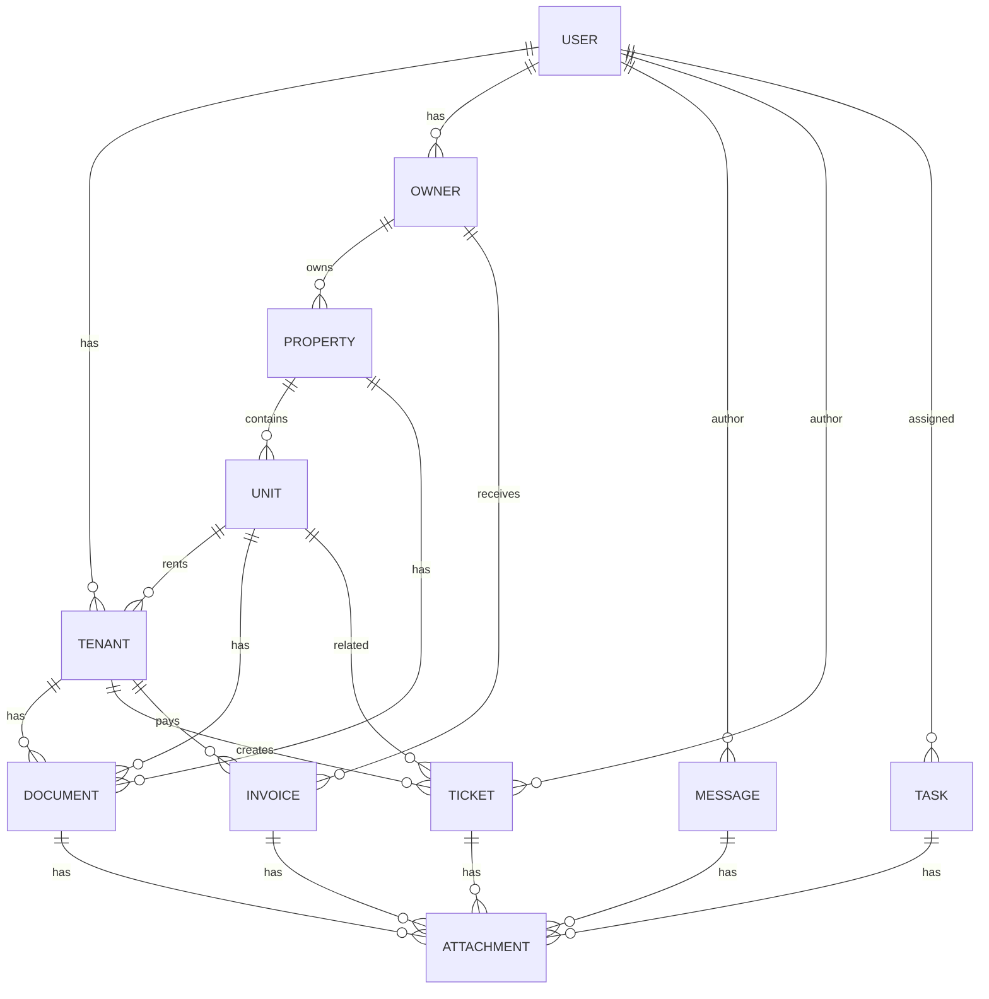

# ER Diagram — Kundenportal Immobilienverwaltung

This captures the core domain relationships for the first iteration: Users (system users), Owners, Properties (Objekte), Units/Wohnungen, Tenants (Mieter), Documents, Tickets, Messages, Tasks and Attachments.
