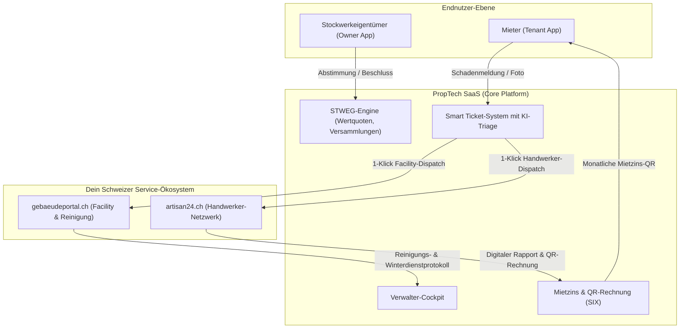
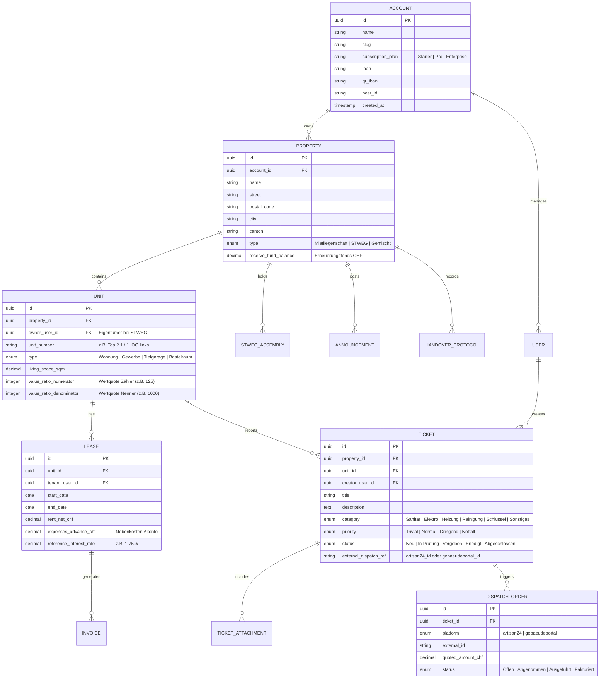
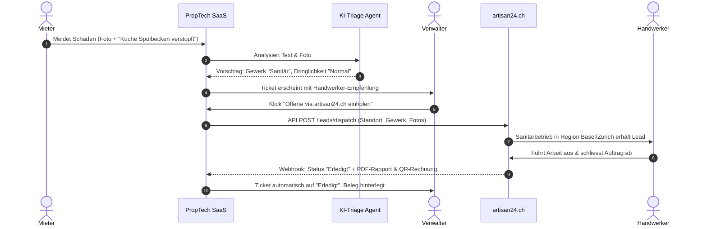

# Softwarespezifikation & Entwicklungs-Blueprint: Schweizer PropTech-SaaS (STWEG & Kleinverwalter)

**Dokument-Version:** 1.0.0  
**Status:** Entwicklungs-Blueprint für Antigravity IDE  
**Zielmärkte:** Schweiz (KMU-Immobilienverwaltungen, Stockwerkeigentümergemeinschaften, private Liegenschaftsbesitzer)  
**Ökosystem-Partner:** `artisan24.ch` (Handwerker), `gebaeudeportal.ch` (Gebäudedienste & Reinigung)

---

## 1. Executive Summary & Zielarchitektur

### 1.1 Ausgangslage & Problemstellung
Kleine bis mittlere Schweizer Immobilienverwaltungen, private Vermieter (2–50 Einheiten) und autonome Stockwerkeigentümergemeinschaften (STWEG, 4–30 Parteien) stehen vor einer digitalen Zwickmühle:
1. **Bestehende Enterprise-Software** (REM, Immotop, W&W, AbaImmo) ist extrem teuer, verlangt monatelange Schulungen und ist für KMU überdimensioniert.
2. **Standard-Büroprogramme (Excel, Word, E-Mail-Postfächer)** führen zu massivem Medienbruch, fehlerhaften Nebenkostenabrechnungen und chaotischer Schadensabwicklung.
3. **Schadensbehebung & Handwerker-Koordination** kostet enorm viel Zeit: Mieter rufen an, Verwalter telefonieren Handwerkern hinterher, Rechnungen kommen per Post und müssen mühsam abgetippt werden.

### 1.2 Die Produktvision: Das „Closed-Loop“-PropTech
Dieses SaaS baut auf der Architektur von `mieterportal-demo.eu` auf und transformiert es in eine mandantenfähige Schweizer PropTech-Suite. Es digitalisiert die Liegenschaftsverwaltung, bietet Mietern und Eigentümern ein modernes Self-Service-Portal und schliesst die Wertschöpfungskette durch **bidirektionale Anbindung an `artisan24.ch` und `gebaeudeportal.ch`**.



---

## 2. Technologiestack & Systemarchitektur

Entwickelt für maximale Konsistenz mit deinem bestehenden Portfolio (`artisan24.ch`, `gebaeudeportal.ch`, `caredesk24.ch`):

* **Backend-Framework:** Laravel 11.x / PHP 8.3+
* **Frontend / Reactive UI:** Laravel Livewire 3.x, Alpine.js, Tailwind CSS (Design System Slate/Emerald/Indigo)
* **Datenbank:** MySQL 8.0+ oder PostgreSQL 16+
* **Multi-Tenancy:** Single-Database Multi-Tenancy via Global Scopes (`account_id` bzw. `company_id`)
* **Asset- & Dokumentenspeicher:** S3-kompatibler Schweizer Cloud-Speicher (z.B. Exoscale, Infomaniak oder Hostpoint S3 Object Storage) zur strikten Einhaltung des **Schweizer revDSG**
* **PDF-Generierung:** `barryvdh/laravel-dompdf` oder Node-basierte Engine (Browsershot) für Vektorgrafik-Qualität bei QR-Rechnungen und Abnahmeprotokollen
* **Mobile Experience:** Progressive Web App (PWA) mit Service Workern für Touch-Signaturen und Schadensfotos vor Ort

---

## 3. Datenmodell & Entity-Relationship-Architektur (ERD)



---

## 4. Kernmodule & Funktionsumfang

### Modul 1: Multi-Tenancy, White-Label & Schweizer Rollensystem

Das System unterscheidet 4 strikt getrennte Benutzerrollen:

1. **Verwalter / Admin (`role: manager`):**
   * Voller Zugriff auf Mandantenebene.
   * Dashboards über Leerstand, offene Mietzinse, Schadensmeldungen und Liegenschafts-KPIs.
2. **Stockwerkeigentümer (`role: owner`):**
   * Zugriff auf eigene Einheiten und das STWEG-Cockpit.
   * Einsicht in Versammlungsprotokolle, Erneuerungsfonds-Saldi und Beschlussfassungen.
3. **Mieter (`role: tenant`):**
   * Einsicht in Mietvertrag, Mietzins-QR-Rechnungen und Nebenkostenabrechnungen.
   * Melden von Mängeln/Schäden mit Live-Status-Tracking.
   * Digitales schwarzes Brett (Liegenschafts-Aushänge).
4. **Hauswart / Handwerker (`role: contractor` / Service):**
   * Eingeschränkter Zugang für Vor-Ort-Erledigungen, Ablesungen und Tickets.

---

### Modul 2: Schweizer STWEG-Cockpit (Art. 712a ff. ZGB)

Für Stockwerkeigentümer-Gemeinschaften unverzichtbar und im Schweizer Markt extrem nachgefragt:

1. **Wertquoten-Rechner:**
   * Hinterlegung von Zähler/Nenner (z.B. 85/1000). Automatische Aufteilung von Gemeinschaftskosten (Heizung, Dachsanierung, Treppenhausreinigung).
2. **Digitale Eigentümerversammlung:**
   * **Traktanden-Planer:** Erstellung der Tagesordnung mit Anhängen (Kostenvoranschläge, Offerten).
   * **Stimmrechts-Register:** Berechnung des Quorums nach Kopfstimmen und Wertquoten nach Schweizer ZGB.
   * **Digitales Beschlussprotokoll:** Rechtssicheres PDF-Protokoll mit 1-Klick-Freigabe durch die Eigentümer.
3. **Erneuerungsfonds-Tracking:**
   * Dokumentation der Pflichteinlagen, Bankkonten-Stand und getätigten Entnahmen für Grossinvestitionen.

---

### Modul 3: Schweizer QR-Rechnung & Nebenkosten-Engine

* **SIX Swiss Payment Standards:**
  * Generierung standardkonformer Schweizer QR-Rechnungen (QR-IBAN mit QR-Referenz oder Standard-IBAN mit SCOR/Non-Reference).
  * Monats-Stapellauf: 1-Klick-Generierung aller Mietzins-Rechnungen am 20. des Vormonats inklusive automatischem E-Mail-Versand oder Download als Sammel-PDF für den Druck.
* **Mietzins- & Referenzzinssatz-Rechner:**
  * Berechnung von Mietzinsreduktionen oder -erhöhungen bei Anpassung des hypothekarischen Referenzzinssatzes durch das BWO (Bundesamt für Wohnungswesen) unter Berücksichtigung von Teuerung (LIK) und allgemeiner Kostensteigerung.
* **Nebenkosten-Abrechnung (BWO/VMWG-konform):**
  * Heiz- und Warmwasserkostenverteilung nach Fläche, Kubatur oder individueller Zählererfassung (VHKA).

---

### Modul 4: Smart Ticket-System & Das Dispatcher-Gateway

Das Herzstück für die Verschmelzung mit deinem Ökosystem:



#### KI-Schadens-Triage:
* Der Mieter tippt eine kurze Notiz oder spricht eine Voice-Message ein (*„Im Bad unter dem Lavabo tropft Wasser auf den Boden“*).
* Die integrierte KI (Claude/Gemini API) erkennt automatisch:
  * **Kategorie:** Sanitär & Heizung
  * **Dringlichkeit:** Hoch (Gefahr von Folgeschäden)
  * **Passende Plattform:** `artisan24.ch`

---

### Modul 5: Digitales Wohnungsübergabeprotokoll (Mobile PWA)

* Entwickelt für Smartphones und Tablets zur Vor-Ort-Wohnungsabnahme.
* Raum-für-Raum-Prüfung (Küche, Bad, Wohnzimmer, Keller) mit standardisierten Schweizer Zustandskategorien:
  * *Neuwertig / Gebrauchsspuren / Instandstellungspflichtig / Mieterschaden*.
* Zählerstände (Strom, Gas, Wasser) mit Belegfoto.
* Schlüsselübergabe-Tabelle (Haustür, Wohnung, Briefkasten, Keller, Badge).
* **Vor-Ort Touch-Signatur:** Verwalter und aus-/einziehende Mieter unterschreiben direkt auf dem Display.
* Sofortige PDF-Erstellung und automatische Zustellung an alle Parteien.

---

## 5. Externe API-Spezifikation (Dispatcher-Schnittstelle)

### 5.1 POST `/api/v1/dispatch/order`
Sendet einen Schadenfall an `artisan24.ch` oder `gebaeudeportal.ch`.

```json
{
  "source_platform": "proptech_saas",
  "account_id": "9b1deb4d-3b7d-4bad-9bdd-2b0d7b3dcb6d",
  "ticket_id": "tick_84920412",
  "target_service": "artisan24",
  "trade": "sanitaer_heizung",
  "urgency": "high",
  "property": {
    "street": "Breisacherstrasse 83",
    "postal_code": "4057",
    "city": "Basel",
    "canton": "BS"
  },
  "contact_person": {
    "name": "Egon Muster",
    "phone": "+41 79 123 45 67",
    "role": "tenant"
  },
  "damage": {
    "title": "Tropfendes Eckventil im Badezimmer",
    "description": "Unter dem Lavabo tritt seit gestern kontinuierlich Wasser aus.",
    "media_urls": [
      "https://storage.proptech.ch/media/tickets/foto_ventil_1.jpg"
    ]
  }
}
```

### 5.2 Webhook `/api/v1/webhooks/dispatch-update`
Empfängt Statusmeldungen und Rechnungen von `artisan24.ch` oder `gebaeudeportal.ch`.

```json
{
  "event": "order.completed",
  "ticket_id": "tick_84920412",
  "contractor": {
    "company_name": "Basel Sanitär GmbH",
    "artisan_id": "art_1092"
  },
  "resolution_summary": "Eckventil ersetzt, Dichtung erneuert. Anlage geprüft und dicht.",
  "invoice": {
    "invoice_number": "RE-2026-0812",
    "amount_net_chf": 185.00,
    "vat_chf": 15.00,
    "total_chf": 200.00,
    "pdf_url": "https://artisan24.ch/invoices/RE-2026-0812.pdf",
    "qr_bill_data": "SPC..."
  }
}
```

---

## 6. SaaS-Preise & Monetarisierungsmodell

Orientiert an deiner erprobten Struktur (Starter CHF 0 / Pro CHF 129 / Enterprise CHF 299):

| Plan | Monatspreis | Enthaltene Einheiten | Features |
| :--- | :--- | :--- | :--- |
| **Starter (Free)** | **CHF 0.-** | Bis 5 Einheiten | 1 Liegenschaft, Mieter- & Eigentümer-Portal, Standard-Tickets, QR-Rechnungen manuell. |
| **Pro** | **CHF 129.-** | Bis 40 Einheiten | Unbegrenzte Liegenschaften, STWEG-Cockpit (Wertquoten & Versammlungen), automatischer Monats-QR-Lauf, 1-Klick Dispatching an Artisan24/Gebäudeportal. |
| **Enterprise** | **CHF 299.-** | Bis 150 Einheiten | Unbegrenzt, Camt.053 Bankenabgleich, digitales Abnahmeprotokoll mit Signatur, Mehrbenutzer-Verwaltung, Prioritäts-Support. |
| *Scale / Addon* | *+ CHF 1.50* | pro weiterer Einheit | Für grosse Verwaltungen über 150 Einheiten. |

---

## 7. Schritt-für-Schritt Implementierungs-Plan für Antigravity IDE

Dieser Ablauf ist so aufbereitet, dass du die Phasen direkt als Entwicklungsauftrag in die IDE geben kannst:

### Phase 1: Multi-Tenancy & Core Datenmodelle
1. Migrationen für `accounts`, `properties`, `units`, `leases` anlegen.
2. Global Scope `TenantScope` implementieren, damit Verwalter nur ihre eigenen Liegenschaften sehen.
3. Anmelde- und Registrierungs-Flow mit Team-/Account-Zuordnung aufbauen.

### Phase 2: Transformation von `mieterportal-demo.eu`
1. Übernahme der bestehenden Livewire-Views für Liegenschaften, Einheiten und Mieter.
2. Einbau der Schweizer Adressvalidierung (Postleitzahlen, Kantone).
3. Anpassung der Benutzerrollen auf `manager`, `owner`, `tenant`.

### Phase 3: STWEG & Wertquoten-Logik
1. Erweiterung der Einheiten um Zähler/Nenner (z.B. 120 / 1000).
2. Modul für Eigentümerversammlungen (Traktanden, Beschlussprotokoll, Stimmrechtsanteile).
3. Saldenführung für den Erneuerungsfonds.

### Phase 4: Schweizer QR-Rechnung & Faktura
1. Integration der SIX-konformen Schweizer QR-Rechnung (`sprain/swiss-qr-bill` oder native SVG/PDF-Engine).
2. Automatisierte Generierung der Monatsmietzinse inkl. QR-Referenz nach Schweizer Standard.

### Phase 5: Das Ökosystem-Gateway (Dispatching)
1. REST-Client und Webhook-Controller zur Kopplung mit `artisan24.ch` und `gebaeudeportal.ch`.
2. Button im Ticket-Cockpit: *„Handwerker-Offerte über artisan24 einholen“*.
3. Automatisches Einlesen von erledigten Rapporten und Rechnungen.
